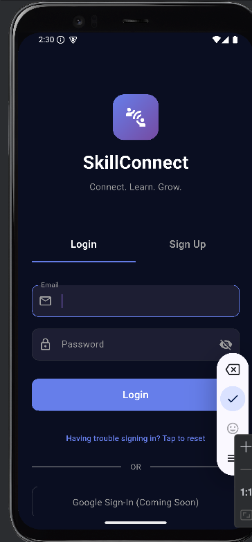
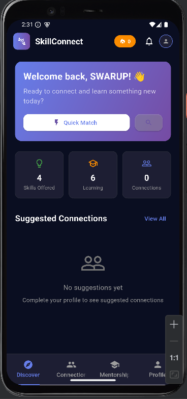
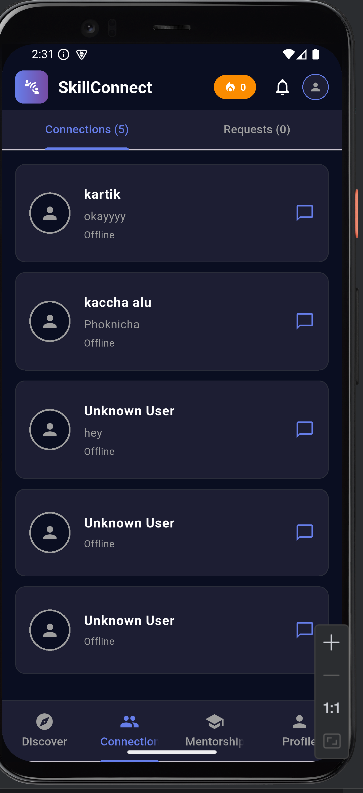
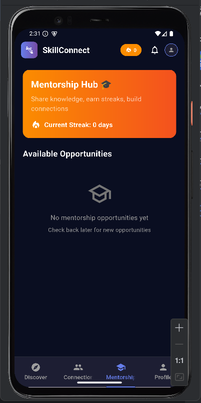
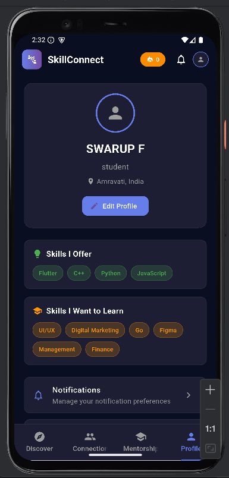

# SkillConnect – Peer Learning Platform 🤝📱

> Match with peers who share your tech learning goals (DSA, Flutter, etc.), build learning streaks, earn mentor badges, and stay consistent — together.

## 🔗 Quick Links 
-  **APK Download:** [Download here](<https://github.com/SwarupFutane/Skillconnect-/releases/download/v1.0.0/app-release.apk>)

- - 🎥 **Demo Video:** [Watch here](<https://drive.google.com/file/d/1998BHjyoiqhd84vJL1_y8x6vSBdCJyih/view?usp=sharing>)

##  Features

-  **Goal-based Peer Matching** — Match users based on domains (DSA, Flutter, etc.), level, and preferences.
-  **Learning Streaks** — Track and gamify consistency.
-  **Mentor Badges** — Recognize users who help the community.
-  **Daily Reminders / Notifications** — Never miss your learning streak.
-  **Firebase Auth** — Secure authentication and user management.
- ️ **Cloud Firestore** — Realtime, scalable backend.
-  **Clean, Minimal UI** — Fast, focused learning workflows.

## 🛠 Tech Stack

- **Framework:** Flutter
- **Language:** Dart
- **Backend / BaaS:** Firebase (Auth, Firestore)
- **State Management:** Provider 
- **Other:** Cloud_firestore, image_picker, SharedPreferences

## 📱 Screenshots

  
  
  
    
    

